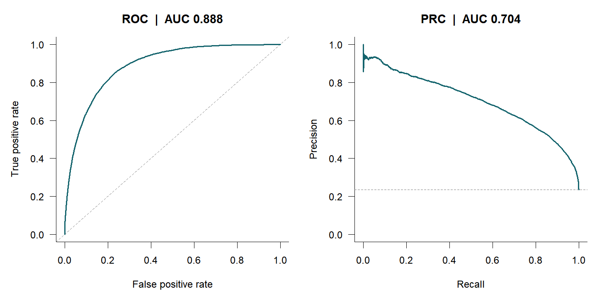

# m6APrediction

m6APrediction uses a random forest to estimate whether an RNA site carries an
N6-methyladenosine (m6A) modification. It supports single-site and batch
predictions from genomic features and a five-base sequence context.

## Install from GitHub

```r
install.packages("remotes")
remotes::install_github("miatang625-byte/m6APrediction")
library(m6APrediction)
```

## Install from the source archive

Run this in R from the directory containing the downloaded archive, or replace
the filename with its full path.

```r
install.packages("randomForest")
install.packages("m6APrediction_1.0.0.tar.gz", repos = NULL, type = "source")
library(m6APrediction)
```

## Predict m6A status

Load the model and example feature table bundled with the installed package.

```r
model <- readRDS(system.file("extdata", "rf_fit.rds",
                            package = "m6APrediction", mustWork = TRUE))
example_data <- read.csv(system.file("extdata", "m6A_input_example.csv",
                                    package = "m6APrediction", mustWork = TRUE))
```

For batch prediction, supply a data frame with the seven feature columns shown
in the single-site example. Exon length and distance to the junction are
already on the log2 scale. Supply an uppercase five-base context with A at
the central position, as in the training data.

```r
prediction_multiple(model, head(example_data, 3), positive_threshold = 0.6)
```

The function appends a numeric positive-class vote fraction and a predicted
status to each row. A site is called Positive when its score is strictly
greater than the threshold.

```r
prediction_single(model, gc_content = 0.6, RNA_type = "mRNA",
                  RNA_region = "CDS", exon_length = 12,
                  distance_to_junction = 5, evolutionary_conservation = 0.8,
                  DNA_5mer = "GGACA", positive_threshold = 0.5)
```

The single-site example returns a named character vector with score
`0.528` and status `Positive`. See `?prediction_single` for the supported
feature values.

## Model performance



The bundled Shiny model contains 500 trees trained on the imbalanced course
dataset. The curves use out-of-bag positive-class votes from the saved fit
for 48,055 sites, including 11,248 positives. For each site, only trees
whose bootstrap sample omitted that site contribute to its out-of-bag score.
ROC AUC is **0.888** and precision–recall AUC is **0.704**. The dashed
precision–recall baseline is the positive fraction (**0.234**).

These scores describe out-of-bag performance on the course dataset. The
100-row CSV is a usage example drawn from the training data. The bundled
Shiny fit gives different example scores from the Practical 6 reference.
